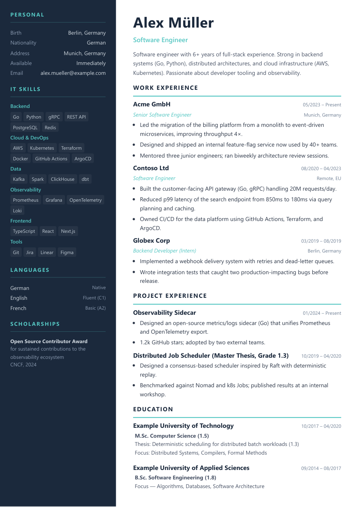
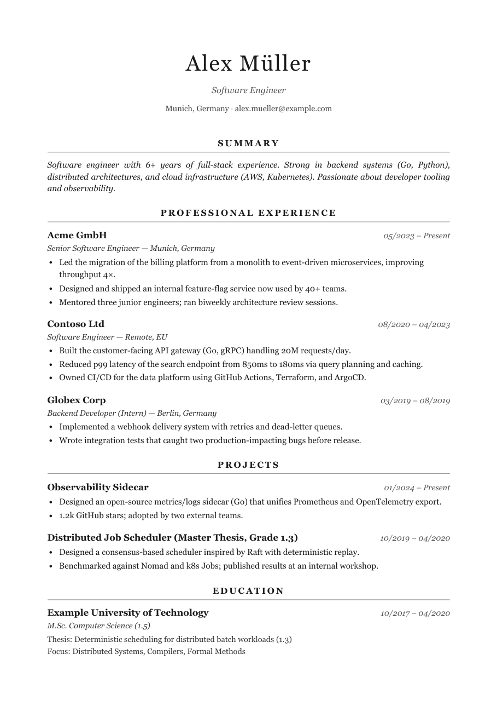
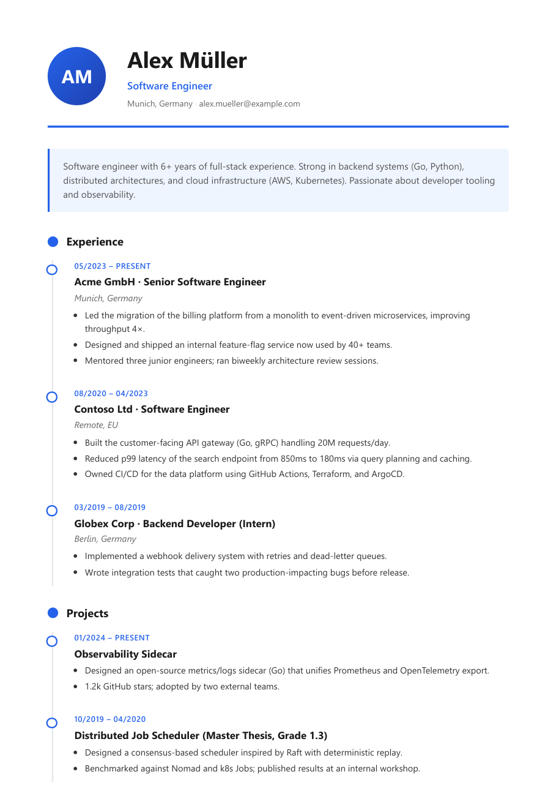

# cv-creator

A [Claude Code](https://claude.com/code) skill that turns raw CV material (an old PDF, markdown notes, plain text, an optional photo) into a clean, ATS-safe PDF, using interchangeable HTML/CSS templates.

中文简介：一个 Claude Code skill，把原始简历素材（PDF、Markdown、文字、照片）整理成结构化数据，再用可切换的 HTML/CSS 模板渲染成 PDF。内容和样式分离，换模板不用改内容。

<table>
  <tr>
    <td></td>
    <td></td>
    <td></td>
  </tr>
  <tr>
    <td align="center"><code>modern-sidebar</code></td>
    <td align="center"><code>classic-single</code></td>
    <td align="center"><code>timeline</code></td>
  </tr>
</table>

*All three were rendered from the same file, [`examples/data.example.yaml`](examples/data.example.yaml) (a fictional person), by switching only the `--pattern` flag.*

## What it does

You give Claude Code your existing material and ask for a CV. The skill:

1. Reads what you provide (PDF text is extracted with `scripts/ingest_pdf.py`).
2. Builds or updates a single `data.yaml` that holds all your content.
3. Asks only for information that is genuinely missing.
4. Renders the data through a template to HTML, then to PDF with headless Edge or Chrome.
5. Checks that the PDF has a selectable text layer, so applicant tracking systems can parse it.

Beyond a single CV, it can also:

- **Keep career-direction variants** ("angles"), for example `data-EN-AI.yaml` and `data-EN-Data.yaml`. Each one uses the same real employers, dates and projects, only reordered and reworded. The skill is instructed not to invent experience, and to push back if an angle is not supported by your actual history.
- **Tailor to a job posting.** Paste a job description and it creates `data-<LANG>-<Company>.yaml` from the closest master or angle file, without overwriting the original.
- **Build many PDFs at once** from a `cv-config.yaml` with a list of targets, each with an optional page budget.

## Install as a Claude Code skill

Requirements:

- [Claude Code](https://claude.com/code)
- [uv](https://docs.astral.sh/uv/) (Python dependencies are declared inline in each script, so there is no virtualenv to manage)
- Microsoft Edge or Google Chrome for PDF output. If neither is found, Playwright is installed and used automatically.

Clone the repo into your personal skills directory:

```bash
# macOS / Linux
git clone https://github.com/z27833009/cv-creator.git ~/.claude/skills/cv-creator

# Windows (Git Bash)
git clone https://github.com/z27833009/cv-creator.git ~/.claude/skills/cv-creator
```

Claude Code picks up new skills automatically. Check that it is loaded by typing `/cv-creator` in a session.

## Usage

```bash
mkdir ~/my-cv && cd ~/my-cv
# put your old CV PDF, notes and (optionally) a photo here
claude
```

Then ask in plain language, for example:

- "Create a CV from old-cv.pdf and photo.jpg using the modern-sidebar template."
- "Add my new project to the CV and render it with the timeline template."
- "Here is a job description. Make a tailored version for this role."

Output files are written next to `data.yaml`:

```
my-cv/
├── data.yaml        your content, reused for every render
├── CV-<name>.pdf    generated
├── CV-<name>.html   generated, useful for checking layout
└── photo.jpg        optional
```

## Example data.yaml

A minimal file:

```yaml
personal:
  name: Jane Doe
  title: Software Engineer
  email: jane@example.com
summary: Backend engineer focused on Python services and cloud infrastructure.
work:
  - title: Example GmbH
    role: Software Engineer
    location: Berlin, Germany
    date: 03/2022 - Present
    bullets:
      - Built and maintained internal REST APIs in Python.
      - Set up CI/CD pipelines with GitHub Actions.
education:
  - title: Example University
    date: 10/2018 - 09/2021
    degree: B.Sc. Computer Science
```

- Full field reference: [`references/data-schema.md`](references/data-schema.md)
- JSON Schema: [`schema/cv.schema.json`](schema/cv.schema.json)
- Complete example used for the screenshots: [`examples/data.example.yaml`](examples/data.example.yaml)

## Templates

Pass the folder name to `--pattern`.

| Pattern | Language | Photo | Pages | Notes |
|---|---|---|---|---|
| `classic-single` | EN | no | 1 to 3 | Single column, serif, black and white. The safest choice for strict ATS pipelines. |
| `modern-sidebar` | EN | yes | 1 to 2 | Dark navy sidebar with skill tags, teal accents. Good for dense tech CVs. |
| `timeline` | EN | yes (or initials) | 1 to 2 | Vertical timeline for experience and education, blue accents. |
| `en-sidebar` | EN | yes | 1 | Compact two-column layout. Shows at most 2 projects. |
| `de-sidebar` | DE | yes | 1 | German labels, same layout as `en-sidebar`. |
| `zh-sidebar` | ZH | yes | 1 | Chinese labels, sidebar layout. |
| `zh-minimalist` | ZH | yes | 1 | Single column, Chinese labels. |
| `zh-classic` | ZH | yes | 1 | Chinese labels. Currently contains a hardcoded university header; edit the template before using it. |

List them from the command line with `uv run scripts/list_patterns.py`. To add your own, copy a pattern folder, edit `template.html.j2` and `meta.yaml`, and see [`references/pattern-authoring.md`](references/pattern-authoring.md).

## Running the builder directly

The renderer works without Claude as well:

```bash
uv run ~/.claude/skills/cv-creator/scripts/build_cv.py \
  --data data.yaml --pattern classic-single --out CV.pdf
```

Useful flags:

- `--no-pdf --html-out preview.html` renders HTML only, for fast layout iteration
- `--engine edge|chrome|playwright|auto` forces a PDF engine
- `--strict` fails the build if the PDF has no selectable text layer
- `--config cv-config.yaml` builds every target listed in the config file

Run `--help` for everything else. If a PDF looks wrong (missing backgrounds, blank photo, CJK characters not showing), see [`references/pdf-troubleshooting.md`](references/pdf-troubleshooting.md).

## Project layout

```
cv-creator/
├── SKILL.md              skill entry point: workflow and rules for Claude
├── schema/               JSON Schema for data.yaml
├── examples/             fully filled example data
├── patterns/             one folder per template (template.html.j2 + meta.yaml)
├── scripts/
│   ├── build_cv.py       data + pattern -> HTML -> PDF
│   ├── ingest_pdf.py     extract text from an existing PDF CV
│   └── list_patterns.py  list available templates
├── references/           longer docs Claude loads only when needed
└── docs/screenshots/     images used in this README
```

The skill follows the [Agent Skills](https://agentskills.io/) format.

## License

MIT, see [LICENSE](LICENSE).
